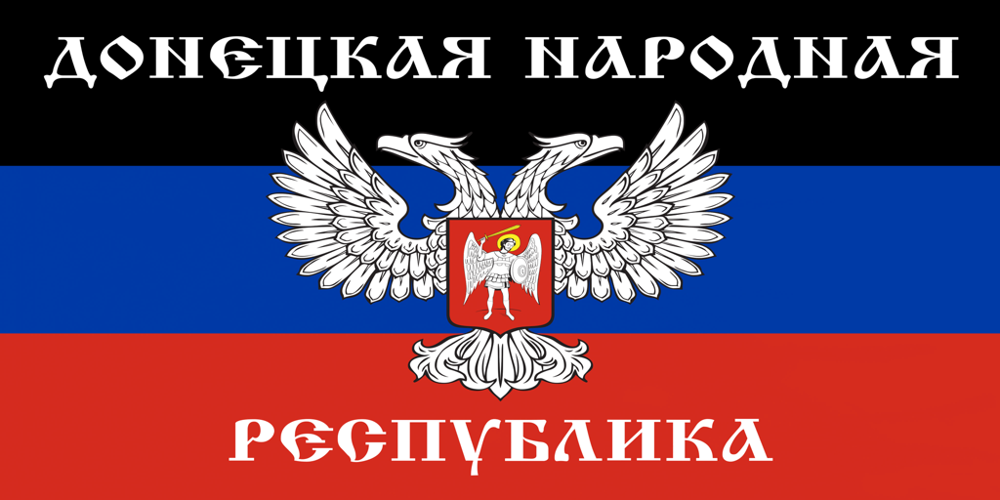

# Флаг ДНР для Rat King (Deadlock)

Аналог мода [deadlockmods.app/mod/723352](https://deadlockmods.app/mod/723352): флаг Украины заменён на флаг ДНР (2014–2018).

## Файлы
- `flag_dnr_rat_king.zip` — только флаг (на базе `flag_ukraine_rat_king`).
- `flag_dnr_rat_king_with_sounds.zip` — флаг + те же звуки, что во втором архиве оригинала (`pak01_dir_bcb73`).

Ставить одну из версий, не обе.

## Установка
1. Распакуйте `pak01_dir.vpk` в `Deadlock/game/citadel/addons/`
   (при необходимости переименуйте в `pak02_dir.vpk` и т.д., если номер занят).
2. В `Deadlock/game/citadel/gameinfo.gi` в `SearchPaths` должны быть строки
   `Game citadel/addons` и `Mod citadel` (как для любых модов).

## Как сделано
Текстура `ratking_ratannia_flag_color` (BC7, 2048×1024, 9 мипов) перекодирована из SVG;
альфа-маска (рваный край флага) сохранена из оригинала. Остальные файлы VPK не тронуты,
CRC и MD5 пересчитаны. Скрипты — в `tools/`.
